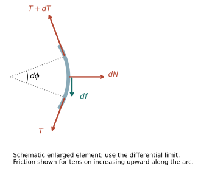
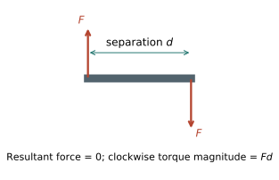
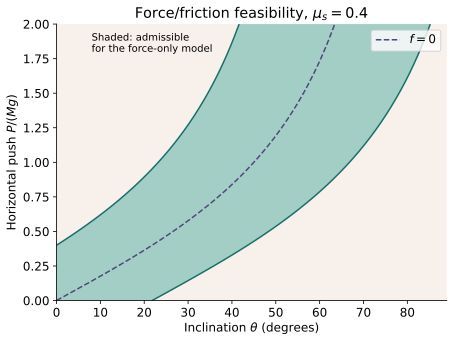
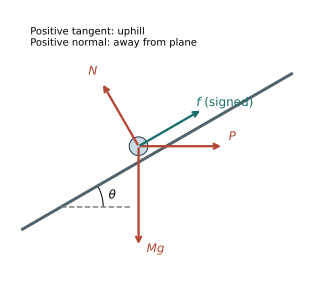
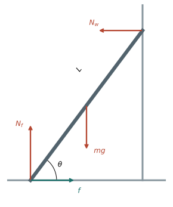

# Morin study supplements and original statics exercises

[Home](../README.md) · [Sources and edition scope](../SOURCES.md#pending)

This index lists the files included in this selected edition. Source-following lessons awaiting review are not linked as if available. Attempt exercises before opening hints or solutions; GitHub search can reveal answer text.

## Explanations and reference

- [Morin Conceptual Network](morin-conceptual-network.md)
- [Morin Laws and Mathematical Techniques](morin-laws-and-mathematical-techniques.md)
- [Morin Mathematical Prerequisites](morin-mathematical-prerequisites.md)

## Original exercises

- [Morin Chapter 2 - Mixed Questions](morin-chapter-2-mixed-questions.md)

## Progressive hints

- [Morin Chapter 2 - Progressive Hints](morin-chapter-2-progressive-hints.md)

## Worked solutions — spoilers

- [Morin Chapter 2 - Solutions](morin-chapter-2-solutions.md)

## Original diagrams

These are separately authored instructional drawings/model plots, not source screenshots.

### statics capstan segment

### statics couple

### statics feasibility

### statics incline

### statics ladder

