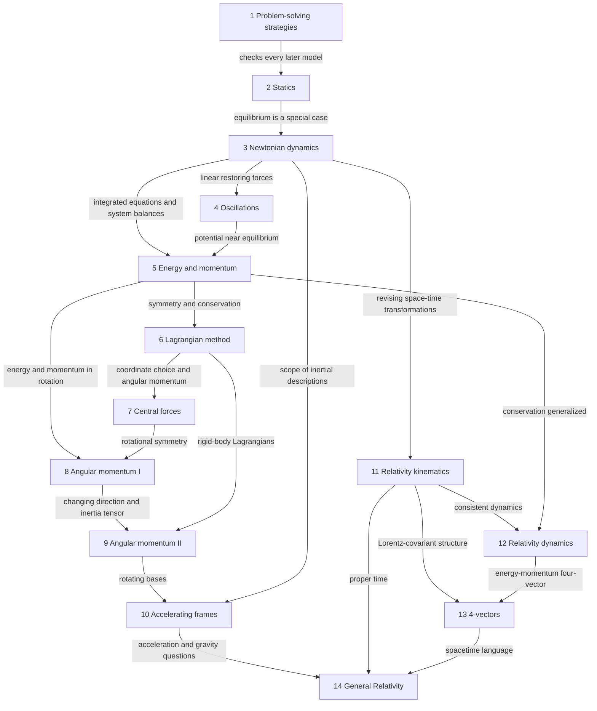

# Morin — Cross-chapter Conceptual Network

> **Edition scope:** original AI-assisted supplement or study material. Some prerequisite lessons are withheld for source review; their titles are plain text, not unavailable links. [Attribution and scope](../SOURCES.md#pending).

> **Review status: unverified.** AI-assisted educational draft; human scientific review remains pending. [Sources and limitations](../SOURCES.md).

> **AI synthesis, not a completion map**
> Chapter/section titles and page anchors come from the uploaded book. The relationships below are AI explanations of how the topics connect. The section-following lessons for §§1.1, 2.1 and 2.2 are withheld from this edition; original supplements and exercises are listed in the [section index](README.md).

[Bibliographic source](../SOURCES.md#morin) · [Mathematical prerequisites](morin-mathematical-prerequisites.md) · [Progress dashboard](README.md)

## Book spine

Chapter 1 is a method layer for **all** later chapters, even though the diagram draws only one outgoing entry arrow for readability. Revisit dimensional consistency, limiting cases, and numerical checks throughout.

## Connections with exact landing points

| Thread | Source anchors | Why the connection matters | Limit or caution |
| --- | --- | --- | --- |
| Representation and constraints | §1.1 p. 1 → §2.1 p. 22 → §3.2 p. 55 → §6.3 p. 227 | A diagram and constraints reduce the unknowns before solving | A coordinate choice does not supply a missing physical law |
| Dimensional and limiting checks | §§1.2–1.3 pp. 4–10 → §4.2 p. 105 → §7.4 p. 287 → §12.1 p. 584 | New formulas should have correct units and suitable known limits | Passing checks is necessary evidence, not a proof of correctness |
| Analytic and numerical evolution | §1.4 p. 11 → §3.3 p. 60 → §4.1 p. 101 → §9.5 p. 393 | Differential equations become initial-value predictions | A numerically smooth trajectory may still have step-size or model errors |
| Equilibrium and stability | §2.1 p. 22 → §4.2 p. 105 → §5.2 p. 147 → §6.7 p. 239 | Static balance asks whether forces cancel; stability asks how a perturbation evolves | Zero net force at a point does not establish stable equilibrium |
| Conservation and symmetry | §§5.1, 5.5 pp. 138, 156 → §§6.5–6.6 pp. 232–238 → §7.1 p. 281 | Conserved quantities reduce dynamical equations and reveal symmetry | Identify the system and relevant symmetry before asserting conservation |
| Frames and the center of mass | §5.6 p. 161 → §8.1 p. 310 → §9.2.2 p. 380 | Motion can be decomposed into center-of-mass and relative pieces | The appropriate formula depends on the origin and frame |
| Orbital and rigid-body angular momentum | §7.1 p. 281 → §8.4 p. 322 → §§9.2–9.3 pp. 376–387 | The same vector balance supports orbit and rotation problems | A rigid body's angular velocity and angular momentum need not be parallel |
| Linear modes and principal axes | §4.5 p. 115 ↔ §§9.2–9.3 pp. 376–387; Appendices D/E pp. 693–697 | Eigenvectors choose directions that simplify coupled equations | Modal coordinates and physical rotation axes are distinct applications |
| Moving bases and inertial effects | §3.5 p. 68 → §9.5 p. 393 → §§10.1–10.2 pp. 458–470 | Differentiating a vector requires accounting for changing basis vectors | Do not mix derivatives in different frames without conversion |
| Galilean to Lorentz kinematics | §3.4 p. 65 → §§11.1, 11.4 pp. 502, 523 | Frame transformations determine how position, time, and velocity compare | Low-speed limits are checks; simultaneity still needs a definition |
| Conservation beyond Newtonian mechanics | §5.7 p. 164 → §12.3 p. 596 → §§13.3–13.4 pp. 637–640 | Energy-momentum conservation persists with changed dynamical quantities | Newtonian kinetic energy cannot be used unchanged at relativistic speeds |
| Accelerated observers and gravity | §10.3 p. 471 → §§14.1–14.3 pp. 649–655 | Acceleration, gravity, and clock rates become connected | Local equivalence does not eliminate tidal effects throughout a finite region |
| Variational principles | §6.2 p. 221 → §14.4 p. 656 | Dynamics can be expressed through stationary functionals | Do not equate every stationary-action statement with a global minimum or maximum |

Use the [index](../SOURCES.md#morin) to open the exact PDF pages. These relationship claims are AI synthesis; the locators identify the topics to compare, not passages that necessarily state the entire cross-chapter argument.

## Reusable concept nodes

### Modeling and validation

Optional method reference: Morin Section 1-1 - General Strategies (not included; [edition scope](../SOURCES.md#pending)). Current teaching starts at Morin Section 2-1 - Balancing Forces (not included; [edition scope](../SOURCES.md#pending)). Record the system, idealizations, knowns, unknowns, constraints, and a check of the result. This node connects to every chapter and to [units and scaling](morin-mathematical-prerequisites.md#section-6).

### Conservation and symmetry

Future thread: Chapters 5, 6, 7, 8, 12 and 13. Ask which quantity is conserved, for which system, relative to which frame or origin, and why. Detailed notes have not been generated.

### Equilibrium, stability, and oscillation

Future thread: Chapters 2, 4, 5, 6, 7 and 9. Ask whether an equilibrium exists and how small departures evolve. Connect with [expansions](morin-mathematical-prerequisites.md#section-9) and [normal-mode mathematics](morin-mathematical-prerequisites.md#section-10).

### Coordinates and frames

Future thread: Chapters 3, 5, 6, 9, 10 and 11. Separate physical motion from its description, and track what is measured in each frame. Coordinate convenience is useful; confusing frames changes the problem.

### Geometry and invariant quantities

Future thread: Chapters 7–9 and 11–14. Geometry makes some relations transparent; invariants provide quantities that survive specified transformations. The relevant transformations and metric must be stated.

## Human verification

Reviewer, date, inspected scope, corrections, limitations, and decision: not yet recorded. All network explanations remain AI drafts; chapter indexing and learner progress are tracked separately.

[Section index](README.md) · [Home](../README.md)
