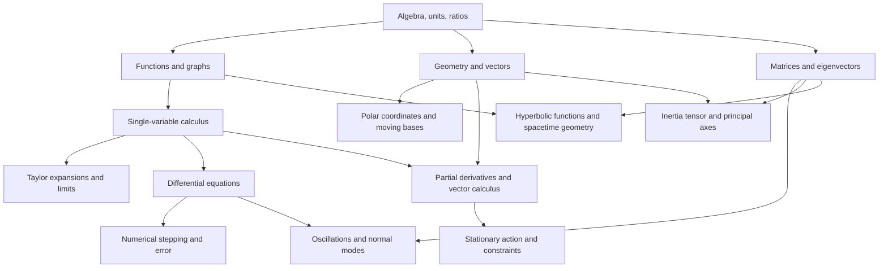

# Morin — Mathematical Prerequisites

> **Edition scope:** original AI-assisted supplement or study material. Some prerequisite lessons are withheld for source review; their titles are plain text, not unavailable links. [Attribution and scope](../SOURCES.md#pending).

> **Review status: unverified.** AI-assisted educational draft; human scientific review remains pending. [Sources and limitations](../SOURCES.md).

> **Provenance and scope**
> **Source-derived:** Morin's Preface, printed p. xiv (PDF 14), names solid high-school mechanics and single-variable calculus as the overall prerequisites, with multivariable/vector calculus reviewed in Appendix B and elementary matrices needed in §§4.5, 9.2–9.3 and Appendices D/E. **AI planning:** the dependency map and explanations below organize these requirements for sequential study; they are not a claim that you have mastered them.

[Dashboard](README.md) · [Bibliographic source](../SOURCES.md#morin) · [Conceptual network](morin-conceptual-network.md)

## Start now

For Chapter 2, start with algebra, trigonometric projections, signed components and moment arms. Morin Section 2-1 - Balancing Forces (not included; [edition scope](../SOURCES.md#pending)) and Morin Section 2-2 - Balancing Torques (not included; [edition scope](../SOURCES.md#pending)) supply the core teaching; [Morin Laws and Mathematical Techniques](morin-laws-and-mathematical-techniques.md) adds optional bridges for selected practice. No Chapter 1 completion is required. The optional §1.1 reference uses symbols, simple equations, units, ratios, and powers of ten. You do not need to finish the entire prerequisite map first. The calculus derivation in its worked teaching example includes the necessary steps; a separate algebraic route is supplied. If either route is unfamiliar, ask for focused teaching.

## Dependency map

These are useful preparation links, not a rigid course order. For example, basic normal-mode work can be introduced before a full linear algebra course.

## Chapter-to-mathematics map

| Chapter | Mathematics to use or learn as needed | Specific source anchors |
| --- | --- | --- |
| 1 Strategies | Algebra; dimensions; expansions; numerical initial-value methods | §§1.1–1.4; Appendix A.1, p. 675 |
| 2 Statics | Vectors in components; trigonometry; simultaneous equations; torque geometry | §§2.1–2.2; B.1–B.2, pp. 679–681 |
| 3 Using F = ma | Derivatives/integrals; separable ODEs; initial conditions; polar unit vectors | §§3.3–3.5, pp. 60–69 |
| 4 Oscillations | Linear ODEs; exponentials and complex notation; matrices/eigenvectors for coupled modes | §§4.1–4.5, pp. 101–119; Appendix E, p. 696 |
| 5 Energy and momentum | Integration; Taylor expansion; gradients and line integrals; curl for §5.3; weighted averages | §§5.1–5.3, pp. 138–152; B.3–B.6, pp. 682–689 |
| 6 Lagrangian method | Partial derivatives; total derivatives; chain rule; variations; coordinate transformations | §§6.1–6.7, pp. 218–242 |
| 7 Central forces | Polar coordinates; ODE substitutions; effective potentials; conic geometry | §§7.1–7.4, pp. 281–295 |
| 8 Angular momentum I | Cross products; moments/integrals over mass; rigid-body geometry | §§8.1–8.4, pp. 310–328 |
| 9 Angular momentum II | Matrices; symmetric tensors; eigenvectors; rotations; coupled ODEs | §§9.1–9.7, pp. 371–414; D/E, pp. 693–697 |
| 10 Accelerating frames | Derivatives of vectors in moving bases; cross products; first-order field differences | §§10.1–10.3, pp. 458–476 |
| 11 Relativistic kinematics | Linear transformations; spacetime diagrams; quadratic forms; hyperbolic functions | §§11.4–11.9, pp. 523–545; Appendix I, p. 708 |
| 12 Relativistic dynamics | Conservation equations; relativistic kinematics; differential relations | §§12.1–12.7, pp. 584–610 |
| 13 4-vectors | Components; Lorentz transformations; invariant bilinear forms; proper-time derivatives | §§13.1–13.6, pp. 634–644 |
| 14 General Relativity | Proper-time integrals; acceleration; approximations; variational reasoning | §§14.1–14.5, pp. 649–659 |

Chapter 14 is a selective introduction, not a complete course in differential geometry or general relativity. A full tensor-calculus course is not being imposed before reading it. The preface also permits skipping §5.3 on a first reading; this is source advice, not an automatic change to a sequential study plan.

## Algebra and independent equations

**AI teaching support for §1.1.** A parameter describes a family of setups (for example, an initial speed); an unknown is what you seek in the present calculation. Either can appear as a letter. Write down which role each letter has before counting equations.

The equations

$$x+y=3,\qquad 2x+2y=6$$

give only one independent condition. Multiplying the first equation by two produces the second. Every pair $(x,y)=(s,3-s)$ satisfies both. Adding $x-y=1$ fixes the pair: addition gives $2x=4$, so $x=2$ and $y=1$.

Thus the number of written lines is not the number of independent facts. For linear systems, uniqueness requires consistency and enough independent equations to determine all unknowns. For nonlinear systems, even one equation in one unknown can have several solutions ($x^2=1$), no real solution ($x^2=-1$), or special parameter cases. Physical inequalities and boundary/initial conditions select admissible solutions. Counting equations is a diagnostic, not a proof of existence or uniqueness.

Dividing by a symbol assumes it is nonzero. Squaring can introduce extra roots. Taking a square root can lose a sign. Preserve these conditions and substitute the candidate answer back into the original equations.

## Units and scaling

**AI teaching support; full treatment belongs to §1.2.** A dimension describes the kind of quantity; a unit is a chosen standard. A length has dimension $L$ and may be measured in metres or kilometres. Write $[v]=LT^{-1}$ for the dimension of speed, and $v=20\,\mathrm{m\,s^{-1}}$ for a particular value.

Only quantities of the same dimension can be added. Both sides of an equation must have the same dimension. Ratios such as $v_2/v_1$ for two speeds are dimensionless. Arguments of ordinary functions such as $\sin$, $\exp$, and $\log$ must be dimensionless; in an expression such as $\log(x/x_*)$, the reference scale $x_*$ supplies the needed units.

If $y=C a^p b^q$ and all other parameters stay fixed, then

$$\frac{y(\lambda a,b)}{y(a,b)}=\lambda^p.$$

This is how a symbolic result explains a change without a fresh calculation. A dimensionless constant $C$, or a dimensionless function of dimensionless parameters, is not determined by dimensional consistency alone.

## Geometry and vectors

**Roadmap; not a completed lesson.** A vector has magnitude and direction; components depend on chosen axes. Learn projections and trigonometry before force balances. Dot products select parallel components; cross products encode an oriented perpendicular direction and an area factor. Appendix B.1–B.2 (printed pp. 679–681, PDF 698–700) provides the book's review. These tools connect §§2.1–2.2 to §§3.2, 5.3, 7.1, 8.4 and 10.2. Do not assume components keep the same meaning when the basis rotates.

## Calculus and differential equations

**AI support for the §1.1 teaching example; broader lessons remain future work.** For one-dimensional motion, velocity is $v=dx/dt$ and acceleration is $a=dv/dt$. These are definitions of rates of change. If $a=-b$ is constant, integration with $v(0)=v_0$ gives

$$v(t)-v_0=\int_0^t(-b)\,ds=-bt.$$

The initial condition supplies the otherwise undetermined integration constant. Integrating the resulting velocity determines displacement. In general, an ODE states a relation among a function and its derivatives; initial or boundary conditions specify the physical member of a solution family. See §§3.3 and 4.1 for the later systematic treatment; §1.4 introduces numerical evolution before those chapters.

## Expansions and limits

**Roadmap.** Understand the distinction between an exact equation and an approximation. Taylor expansion of a sufficiently differentiable function near $x_0$ organizes changes in powers of $x-x_0$; an approximation needs an interval or a small dimensionless parameter, not just a claim that a dimensional number is “small.” Relevant reading: §1.3 and Appendix A.1. A limit can leave the original model's domain, so do not demand that an invalid model remain realistic there.

## Matrices and eigenvectors

**Roadmap.** Learn matrix-vector multiplication, linear systems, eigenvalues, and eigenvectors before the parts of §§4.5 and 9.2–9.3 that need them. An eigenvector retains its direction under a linear map; the eigenvalue gives its scale factor. This explains why normal modes and principal axes share mathematical structure. Appendices D/E support the rotational application. These notes do not claim that normal modes or inertia tensors have already been taught.

## Multivariable calculus and variations

**Roadmap.** Distinguish a partial derivative (vary one independent variable while holding the others fixed) from a total derivative along a trajectory. Appendix B.3–B.6 supports the gradient, divergence, and curl; Chapter 6 introduces the stationary-action method. A “stationary” value is not necessarily a minimum. Full derivations await the relevant chapter.

## Spacetime mathematics

**Roadmap.** Ordinary vector skills help, but spacetime's invariant quadratic form differs from a Euclidean sum of squares. Learn events, intervals, Lorentz transformations, and proper time in Chapter 11 before the dynamics of Chapter 12 and 4-vectors of Chapter 13. Hyperbolic functions connect to rapidity in §11.9. The map is a preview, not an assumed prerequisite mastery claim.

## Human verification

Reviewer: not recorded. Date: not recorded. Scope checked by a human: none recorded. Corrections and decision: pending. AI source checks and symbolic checks are recorded separately in internal review documentation (not included in this collection).

[Section index](README.md) · [Home](../README.md)
