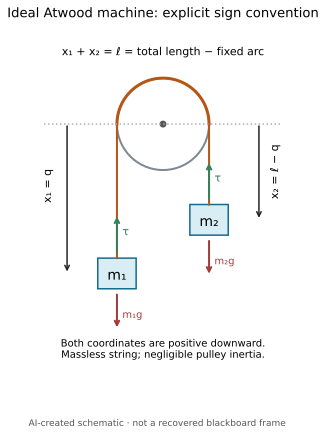
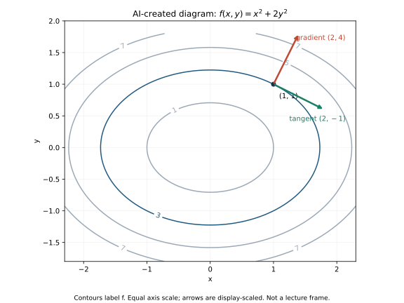
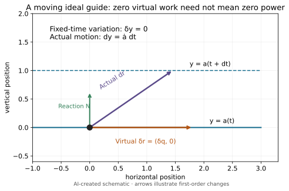
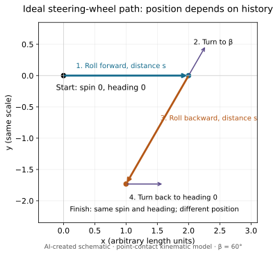

# Theoretical mechanics — Lecture 01 supplements

[Home](../../README.md) · [Sources and edition scope](../../SOURCES.md#pending)

This index lists the files included in this selected edition. Source-following lessons awaiting review are not linked as if available. Attempt exercises before opening hints or solutions; GitHub search can reveal answer text.

## Original exercises

- [AM01 Mixed Physics Practice](am01-mixed-physics-practice.md)

## Progressive hints

- [AM01 Physics Progressive Hints](am01-physics-progressive-hints.md) — selected original question IDs only

## Worked solutions — spoilers

- [AM01 Physics Worked Solutions](am01-physics-worked-solutions.md) — selected original question IDs only

## Original diagrams

These are separately authored instructional drawings/model plots, not source screenshots.

### AM01 atwood

### AM01 gradient contour

### AM01 moving guide

### AM01 wheel path

