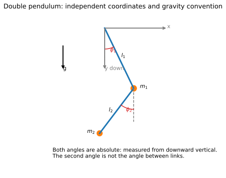
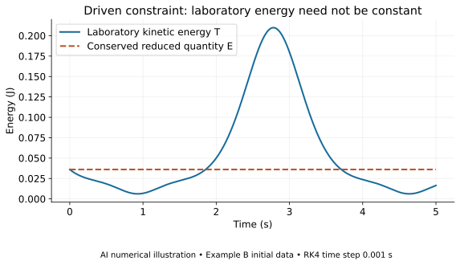
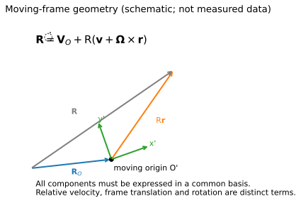
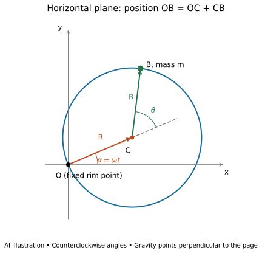
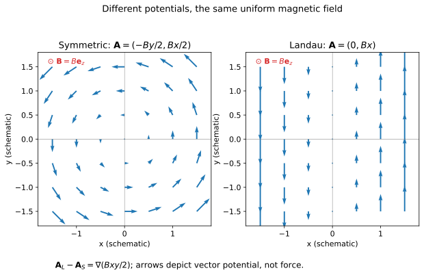
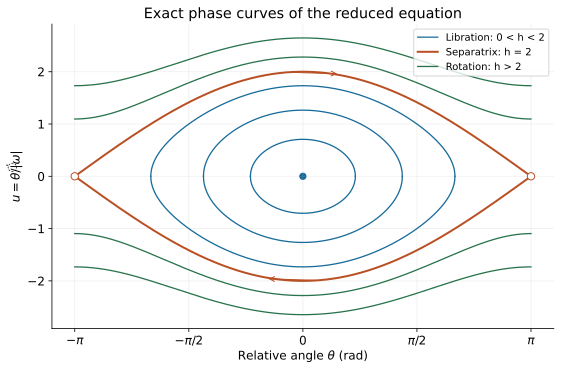
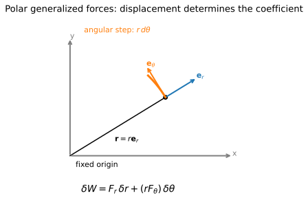

# Theoretical mechanics — Lecture 02 supplements

[Home](../../README.md) · [Sources and edition scope](../../SOURCES.md#pending)

This index lists the files included in this selected edition. Source-following lessons awaiting review are not linked as if available. Attempt exercises before opening hints or solutions; GitHub search can reveal answer text.

## Original exercises

- [AM02 Final Focused Physics Practice](am02-final-focused-physics-practice.md) — selected original question IDs only
- [AM02 Final Mixed Physics Practice](am02-final-mixed-physics-practice.md) — selected original question IDs only

## Progressive hints

- [AM02 Final Physics Hints](am02-final-physics-hints.md) — selected original question IDs only

## Worked solutions — spoilers

- [AM02 Final Physics Solutions](am02-final-physics-solutions.md) — selected original question IDs only

## Original diagrams

These are separately authored instructional drawings/model plots, not source screenshots.

### AM02 double pendulum

### AM02 energy exchange

### AM02 frame kinematics

### AM02 hoop geometry

### AM02 magnetic gauges

### AM02 phase curves

### AM02 polar work

